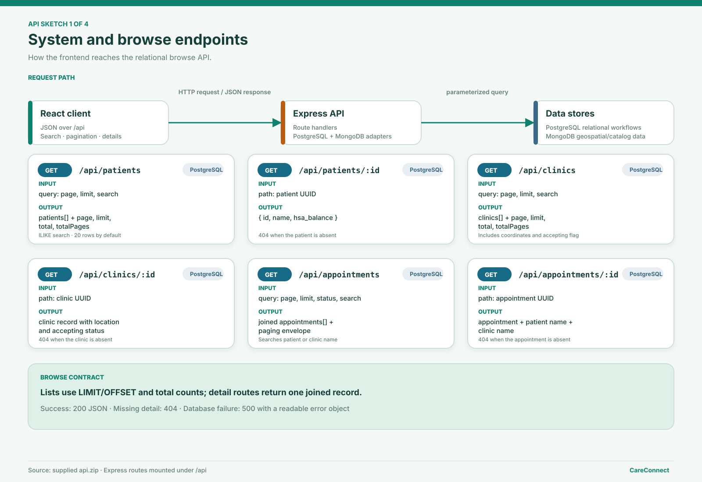
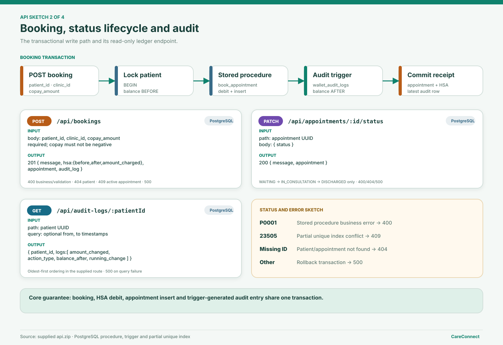
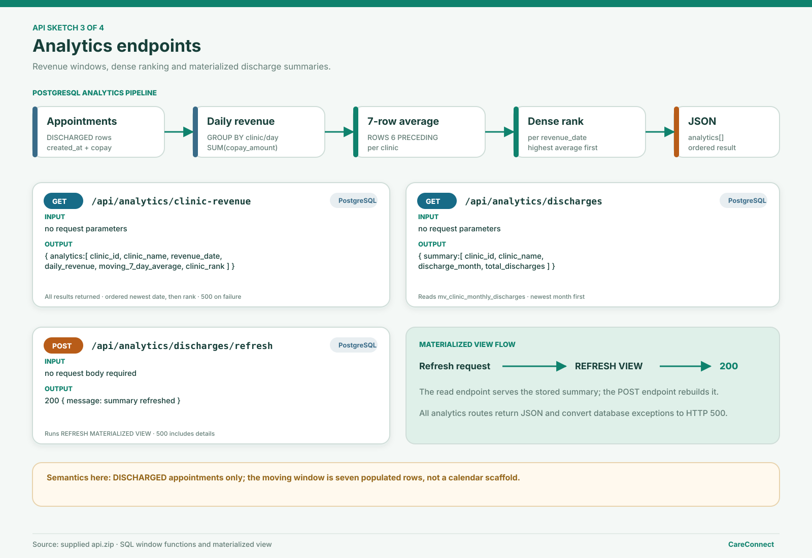
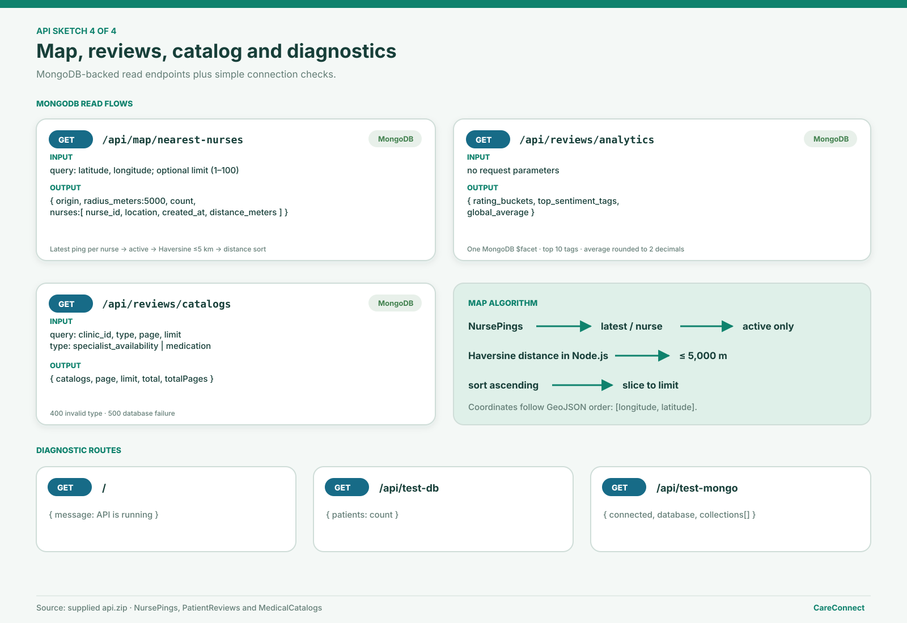

# CareConnect API Sketch and Endpoint Contracts

This document describes the Express API implemented in the supplied `api.zip`. The service uses JSON requests and responses, PostgreSQL for patients, clinics, appointments, transactions, audit logs and analytics, and MongoDB for nearby nurses, reviews and medical catalogs.

**Default server:** `http://localhost:5000`

**Main API prefix:** `/api`

**Authentication:** Not implemented; this is a local academic demonstration.

## Visual API sketches

Place the SVG files in `docs/design/api-sketches/` so these relative links render from `docs/api_endpoints.md`.









## Shared conventions

- Request and response bodies use JSON.
- PostgreSQL UUIDs are represented as strings.
- List routes use `page` and `limit` query parameters. Their default values are `1` and `20`.
- Search on patient and clinic names uses PostgreSQL `ILIKE`.
- Successful GET and PATCH requests return HTTP `200` unless stated otherwise.
- A successful booking returns HTTP `201`.
- Errors use the shape `{ "error": "message" }`.
- Database failures normally return HTTP `500`.

## System and connection checks

### GET `/`

Simple server availability check.

**Response — 200**

```json
{
  "message": "CareConnect API is running"
}
```

### GET `/api/test-db`

Checks the PostgreSQL connection by counting patients.

**Response — 200**

```json
{
  "patients": "5000"
}
```

Returns `500` with `Database connection failed` when PostgreSQL cannot be queried.

### GET `/api/test-mongo`

Checks the MongoDB connection and lists available collections.

**Response — 200**

```json
{
  "connected": true,
  "database": "careconnect",
  "collections": ["NursePings", "PatientReviews", "MedicalCatalogs"]
}
```

Returns `500` with `connected: false` when MongoDB is unavailable.

## Browse and detail endpoints

### GET `/api/patients`

Returns a paginated, name-filtered patient directory.

| Query parameter | Required | Meaning |
|---|---:|---|
| `page` | No | Page number; default `1` |
| `limit` | No | Rows per page; default `20` |
| `search` | No | Case-insensitive partial patient-name search |

**Response — 200**

```json
{
  "patients": [
    {
      "id": "<patient UUID>",
      "name": "Aditi Sharma",
      "hsa_balance": "2500.00"
    }
  ],
  "page": 1,
  "limit": 20,
  "total": 5000,
  "totalPages": 250
}
```

### GET `/api/patients/:id`

Returns one patient as `{ id, name, hsa_balance }`. Returns `404` when the UUID does not identify a patient.

### GET `/api/clinics`

Returns paginated clinics. Query parameters are `page`, `limit` and `search`.

Each clinic contains:

```json
{
  "id": "<clinic UUID>",
  "name": "Adyar Family Clinic",
  "latitude": "13.0827",
  "longitude": "80.2707",
  "is_accepting_patients": true
}
```

The response also contains `page`, `limit`, `total` and `totalPages`.

### GET `/api/clinics/:id`

Returns one clinic with its coordinates and accepting-patients flag. Returns `404` when the clinic is absent.

### GET `/api/appointments`

Returns joined appointment records with patient and clinic names.

| Query parameter | Required | Meaning |
|---|---:|---|
| `page` | No | Page number; default `1` |
| `limit` | No | Rows per page; default `20` |
| `status` | No | Appointment status filter |
| `search` | No | Partial patient-name or clinic-name search |

Each record contains `id`, `patient_id`, `patient_name`, `clinic_id`, `clinic_name`, `copay_amount`, `status` and `created_at`. Results are ordered by newest `created_at` first. The response includes the normal paging fields.

### GET `/api/appointments/:id`

Returns one joined appointment record. Returns `404` when the appointment is absent.

## Booking transaction

### POST `/api/bookings`

Books an appointment by calling the inherited PostgreSQL stored procedure inside a transaction.

**Request body**

```json
{
  "patient_id": "<patient UUID>",
  "clinic_id": "<clinic UUID>",
  "copay_amount": "100.00"
}
```

All three fields are required. A negative copay is rejected.

**Transaction flow**

1. Start a transaction.
2. Lock the selected patient with `FOR UPDATE`.
3. Read the HSA balance before booking.
4. Call `book_appointment(patient_id, clinic_id, copay_amount)`.
5. Read the HSA balance after booking.
6. Read the newly created appointment and latest audit entry.
7. Commit and return the receipt; roll back on failure.

**Response — 201**

```json
{
  "message": "Appointment booked successfully",
  "hsa": {
    "before": "2500.00",
    "after": "2400.00",
    "amount_charged": "100.00"
  },
  "appointment": {
    "id": "<appointment UUID>",
    "patient_id": "<patient UUID>",
    "patient_name": "Aditi Sharma",
    "clinic_id": "<clinic UUID>",
    "clinic_name": "Adyar Family Clinic",
    "copay_amount": "100.00",
    "status": "WAITING",
    "created_at": "<timestamp>"
  },
  "audit_log": {
    "id": "<audit UUID>",
    "patient_id": "<patient UUID>",
    "amount_changed": "-100.00",
    "action_type": "DEDUCTION",
    "balance_after": "2400.00",
    "timestamp": "<timestamp>"
  }
}
```

| Status | Meaning |
|---:|---|
| `400` | Missing input, negative copay or stored-procedure business error (`P0001`) |
| `404` | Patient not found |
| `409` | Patient already has a WAITING or IN_CONSULTATION appointment (`23505`) |
| `500` | Unexpected transaction or database failure |

## Appointment lifecycle

### PATCH `/api/appointments/:id/status`

Allows only the following forward transitions:

```text
WAITING → IN_CONSULTATION → DISCHARGED
```

**Request body**

```json
{
  "status": "IN_CONSULTATION"
}
```

**Response — 200**

```json
{
  "message": "Appointment status updated successfully",
  "appointment": {
    "id": "<appointment UUID>",
    "patient_id": "<patient UUID>",
    "clinic_id": "<clinic UUID>",
    "copay_amount": "100.00",
    "status": "IN_CONSULTATION",
    "created_at": "<timestamp>"
  }
}
```

Missing or invalid target status returns `400`; an unknown appointment returns `404`; database failure returns `500`.

## HSA audit trail

### GET `/api/audit-logs/:patientId`

Returns wallet audit entries for a patient.

| Query parameter | Required | Meaning |
|---|---:|---|
| `from` | No | Minimum audit timestamp |
| `to` | No | Maximum audit timestamp |

**Response — 200**

```json
{
  "patient_id": "<patient UUID>",
  "logs": [
    {
      "id": "<audit UUID>",
      "patient_id": "<patient UUID>",
      "amount_changed": "-100.00",
      "action_type": "DEDUCTION",
      "balance_after": "2400.00",
      "timestamp": "<timestamp>",
      "running_change": "-100.00"
    }
  ]
}
```

The supplied route orders entries by timestamp and ID from oldest to newest. `running_change` is the cumulative sum of `amount_changed` in that order. Query failure returns `500`.

## PostgreSQL analytics

### GET `/api/analytics/clinic-revenue`

Returns revenue analytics for discharged appointments. The query:

1. Groups discharged appointments by clinic and appointment date.
2. Sums daily copay revenue.
3. Calculates an average over the current and six preceding populated rows per clinic.
4. Applies `DENSE_RANK` for each revenue date.

**Response — 200**

```json
{
  "analytics": [
    {
      "clinic_id": "<clinic UUID>",
      "clinic_name": "Adyar Family Clinic",
      "revenue_date": "2026-10-15",
      "daily_revenue": "7200.00",
      "moving_7_day_average": "6814.29",
      "clinic_rank": "1"
    }
  ]
}
```

The route accepts no request parameters and returns all result rows.

### GET `/api/analytics/discharges`

Reads the `mv_clinic_monthly_discharges` materialized view.

```json
{
  "summary": [
    {
      "clinic_id": "<clinic UUID>",
      "clinic_name": "Adyar Family Clinic",
      "discharge_month": "2026-10-01",
      "total_discharges": "42"
    }
  ]
}
```

Rows are ordered by newest month and then clinic name.

### POST `/api/analytics/discharges/refresh`

Runs:

```sql
REFRESH MATERIALIZED VIEW public.mv_clinic_monthly_discharges;
```

**Response — 200**

```json
{
  "message": "Monthly discharge summary refreshed successfully"
}
```

Refresh failure returns `500`.

## Nearby nurses

### GET `/api/map/nearest-nurses`

Returns active nurses whose latest ping is within five kilometres of an origin.

| Query parameter | Required | Meaning |
|---|---:|---|
| `latitude` | Yes | Origin latitude from `-90` to `90` |
| `longitude` | Yes | Origin longitude from `-180` to `180` |
| `limit` | No | Result limit clamped to `1–100`; default `20` |

**Processing flow**

1. Sort and group `NursePings` to select the latest ping for each nurse.
2. Keep active pings.
3. Calculate Haversine distance in Node.js.
4. Keep distances at or below `5000` metres.
5. Sort by distance and apply the requested limit.

GeoJSON coordinates use `[longitude, latitude]` order.

**Response — 200**

```json
{
  "origin": {
    "latitude": 13.0827,
    "longitude": 80.2707
  },
  "radius_meters": 5000,
  "count": 1,
  "nurses": [
    {
      "nurse_id": "nurse-101",
      "location": {
        "type": "Point",
        "coordinates": [80.2707, 13.0827]
      },
      "created_at": "<timestamp>",
      "distance_meters": 0
    }
  ]
}
```

Invalid or missing coordinates return `400`; processing failure returns `500`.

## Review analytics

### GET `/api/reviews/analytics`

Runs one MongoDB `$facet` pipeline over `PatientReviews`.

**Response — 200**

```json
{
  "rating_buckets": [
    { "_id": 5, "count": 820 }
  ],
  "top_sentiment_tags": [
    { "_id": "professional", "count": 652 }
  ],
  "global_average": [
    { "avg_rating": 4.35, "total_reviews": 1500 }
  ]
}
```

The facets calculate rating counts, the ten most common tags, and the rounded overall average/count. MongoDB failure returns `500`.

## Medical catalogs

### GET `/api/reviews/catalogs`

Returns flexible `MedicalCatalogs` documents.

| Query parameter | Required | Meaning |
|---|---:|---|
| `clinic_id` | No | Exact clinic reference filter |
| `type` | No | `specialist_availability` or `medication` |
| `page` | No | Page number; minimum `1`, default `1` |
| `limit` | No | Rows per page; clamped to `1–100`, default `20` |

**Response — 200**

```json
{
  "catalogs": [
    {
      "_id": "<MongoDB document ID>",
      "clinic_id": "<clinic UUID>",
      "type": "medication",
      "name": "Paracetamol",
      "dosage_mg": 500,
      "in_stock": 120
    }
  ],
  "page": 1,
  "limit": 20,
  "total": 200,
  "totalPages": 10
}
```

An unsupported catalog type returns `400`; MongoDB failure returns `500`.

## Endpoint summary

| Method | Path | Store | Purpose |
|---|---|---|---|
| GET | `/` | — | API availability |
| GET | `/api/test-db` | PostgreSQL | PostgreSQL connection check |
| GET | `/api/test-mongo` | MongoDB | MongoDB connection check |
| GET | `/api/patients` | PostgreSQL | Paginated patient directory |
| GET | `/api/patients/:id` | PostgreSQL | Patient detail |
| GET | `/api/clinics` | PostgreSQL | Paginated clinic directory |
| GET | `/api/clinics/:id` | PostgreSQL | Clinic detail |
| GET | `/api/appointments` | PostgreSQL | Search/filter appointments |
| GET | `/api/appointments/:id` | PostgreSQL | Appointment detail |
| POST | `/api/bookings` | PostgreSQL | Transactional appointment booking |
| PATCH | `/api/appointments/:id/status` | PostgreSQL | Forward status transition |
| GET | `/api/audit-logs/:patientId` | PostgreSQL | Patient HSA audit trail |
| GET | `/api/analytics/clinic-revenue` | PostgreSQL | Window-function revenue analytics |
| GET | `/api/analytics/discharges` | PostgreSQL | Materialized discharge summary |
| POST | `/api/analytics/discharges/refresh` | PostgreSQL | Refresh materialized view |
| GET | `/api/map/nearest-nurses` | MongoDB | Latest active nurses within 5 km |
| GET | `/api/reviews/analytics` | MongoDB | `$facet` review analytics |
| GET | `/api/reviews/catalogs` | MongoDB | Paginated flexible catalogs |
